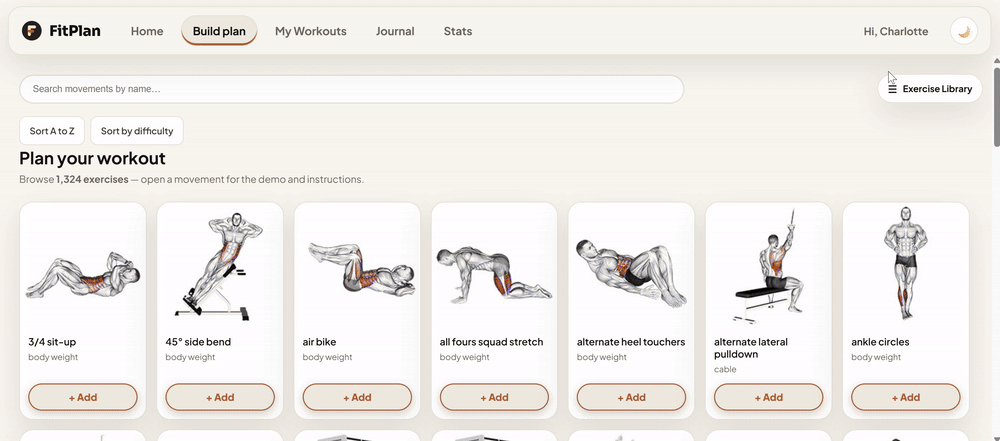
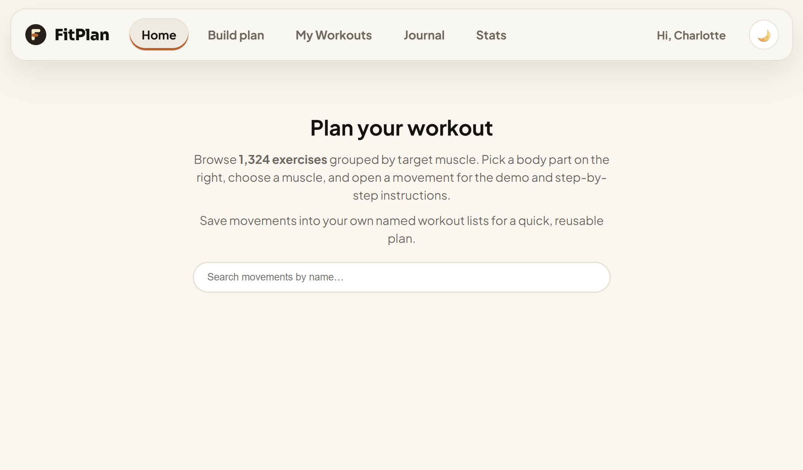

[English](README.md) | [中文](README.zh.md)

# Fitness Planner

A full-stack workout planner built around a 1,324-exercise library. Browse movements by body part → target muscle, watch animated demos, build named workout lists, log live sessions with a rest timer, and track recovery, bodyweight, and strength-balance analytics. English and Chinese UI.
[](./media/demo.mp4)

## ▶️ Live Demo

<a href="https://gotham-citizen.github.io/Fitness-Planner/">
  
</a>

Click the link to try it! The deployed frontend talks to a live [Cloudflare Worker](https://fitness-planner.myenglishnameisbennie.workers.dev/api/health) API backed by Cloudflare D1. Browse the exercise library as a guest, or create an account to build workout lists, log sessions, and track your progress.

## Getting Started

### Prerequisites

- Node.js (v24+)
- Optional: a Cloudflare account — only needed to deploy your own API or run against a remote D1 database

### Setup

```bash
npm install
npm run fetch:data        # download the dataset + exercise media into public/ and server/data/
npm run db:gen           # generate server/seed.sql from the dataset
npm run db:schema:local  # create the local (Miniflare) D1 schema
npm run db:data:local    # load the seed data
npm run dev              # Vite (web, :5173) + wrangler dev --local (API, :8787)
```

Opens at `http://localhost:5173` and works fully offline.

> `server/data/` and `server/seed.sql` are gitignored by design — a fresh clone regenerates them with `npm run fetch:data` + `npm run db:gen`. Auth also needs a `JWT_SECRET`; for local development put it in `server/.dev.vars` (gitignored), e.g. `JWT_SECRET=any-long-random-string`.

All configuration values are optional for local development (see `.env.example`):

| Variable | Meaning |
| --- | --- |
| `VITE_API_BASE` | Absolute Worker API URL when the frontend is hosted elsewhere (e.g. GitHub Pages); omit for same-origin |
| `VITE_BASE` | Base path the app is served from — `/` by default, `/<repo-name>/` on GitHub Pages (set by the deploy workflow) |
| `CORS_ORIGIN` | Server-side allowed API origin, `*` by default |
| `API_TARGET` | Vite dev-proxy target for `/api` — defaults to the local wrangler dev server (`http://localhost:8787`) |

### Deploy the Worker

```bash
npx wrangler login
npx wrangler d1 create fitness-db
#    paste the returned database_id into server/wrangler.jsonc

npm run db:schema:remote
npm run db:data:remote

npx wrangler secret put JWT_SECRET --config server/wrangler.jsonc
npm run deploy                     # builds the frontend and deploys everything as one Worker
```

The Worker serves the built frontend, all media, and the API from a single origin (`nodejs_compat` + static assets with SPA fallback). Alternatively run the web half separately:

```bash
npm run dev:web   # Vite only — /api is proxied (to the local Worker, or API_TARGET if set)
npm run dev:api   # wrangler dev --local only (port 8787)
```

### Deploy the frontend to GitHub Pages

GitHub Pages is static-only, so the API stays on Cloudflare Workers:

1. Deploy the Worker first (above) and note its URL, e.g. `https://fitness-planner.<your-subdomain>.workers.dev`.
2. Push the repo to GitHub and add a repository **Variable** named `VITE_API_BASE` set to that Worker URL.
3. In **Settings → Pages**, set Source to **"GitHub Actions"**.
4. Push to `main`. The [deploy workflow](.github/workflows/deploy-pages.yml) builds with `VITE_BASE=/<repo-name>/` and `VITE_API_BASE`, then publishes `dist/`.

Cross-origin calls are permitted by the CORS middleware in `server/app.js` (controlled by `CORS_ORIGIN`).

### Build for Production

```bash
npm run build
npm run preview
```

## Features

- **1,324-exercise library** — browse body part → target muscle → movements, with looping GIF demos, thumbnails, equipment, target/primary/secondary muscles, and step-by-step instructions
- **Search that speaks 中文** — matches English, Chinese, or pinyin (`wo tui` finds 腿部 movements); the search box is IME-safe so pinyin composition never trips it
- **Equipment browser** — 23 photo cards (one PNG per equipment type in `public/equipment/`, "Other" pinned last) that drill down into that equipment's movements; sort by count, A→Z, or difficulty
- **Custom exercises** — create, edit, and delete your own movements (name, category, target muscle, equipment); they merge into the library and are scoped to your account
- **Accounts** — email + password signup/login with JWT sessions; profile with display name, gender, bodyweight + unit (kg/lb), effort scale, timer alert settings, and UI language
- **Workout lists** — named lists with add/remove exercises, per-exercise rest-timer settings, rename, and delete; duplicate names are caught case-insensitively
- **Live sessions** — start a workout from any list; log sets with reps, weight, kg/lb, and effort; edit or delete sets; **Finish** blocks sets that have weight but no reps
- **RIR / RPE effort tracking** — rate sets as RIR (0–4, 0 = failure) or RPE (6–10, 10 = failure); averages, hard-set classification, and weekly effort stats require a minimum of rated sets
- **Rest timer** — per-exercise rest settings with sound (beep / chime / bell), vibrate, and flash alerts, all configurable in Account → Timer Alerts
- **Session summary** — per-exercise set stats and rank progression after finishing (Iron → Challenger, calibrated on StrengthLevel entire-community 1RM averages), plus comparison against your previous sessions
- **Per-list history** — revisit any past session's summary; delete single sessions or clear a list's history
- **Training journal** — day-by-day session log with list filters, plus bodyweight weigh-ins, a trend chart, and a target-weight goal
- **Muscle balance** — trained-vs-untrained muscle map, and **structural balance**: your estimated 1RMs (Epley-style formulas) against bodyweight-relative strength standards, gender-aware
- **Recovery tracking** — per-target-muscle recovery state computed from your recent sessions, shown on the Workouts page
- **Recent muscles** — recently viewed/trained targets resurface in the library's Recent tab, with "not explored yet" markers
- **Bilingual, themed, responsive** — English/中文 UI (browser detection, overridable per account), dark/light themes, and a mobile tab-bar layout

## How It Works

1. The exercise library loads from the API (`/api/exercises`) — 1,324 movements from the [hasaneyldrm/exercises-dataset](https://github.com/hasaneyldrm/exercises-dataset) with GIFs and thumbnails bundled locally in `public/`.
2. Guests browse freely (the endpoint uses optional auth); signing in unlocks custom exercises, workout lists, and logging.
3. A live session is created from a list (`POST /api/workoutlists/:id/sessions`); every set is persisted individually as you log it, so the session survives reloads and can be edited mid-workout.
4. Finishing (`PUT /api/sessions/:id/complete`) validates sets, stores the summary, and feeds the journal, history, recovery, balance, and rank features — all computed client-side from your session history.
5. One Express app (`server/app.js`) runs both as a Cloudflare Worker (via `server/worker.js` + D1) and locally (via `wrangler dev --local` + Miniflare D1) — a single code path for both.

### API reference

| Method | Route | Description |
| --- | --- | --- |
| GET | `/api/health` | Liveness check |
| POST | `/api/auth/signup` | Create account `{ email, password, name, gender? }` |
| POST | `/api/auth/login` | Log in `{ email, password }` |
| GET | `/api/auth/me` | Current user |
| PUT | `/api/auth/profile` | Update `{ email?, name?, gender?, bodyweight?, bodyweightUnit?, effortScale?, timerSound?, timerPlaySound?, timerVibrate?, timerFlash?, language? }` |
| DELETE | `/api/auth/me` | Delete account |
| GET | `/api/exercises` | All exercises (guests get the seed library; authed users also get their custom ones) |
| POST | `/api/exercises` | Create a custom exercise |
| GET | `/api/exercises/:id` | Single exercise detail |
| PUT | `/api/exercises/:id` | Update a custom exercise |
| DELETE | `/api/exercises/:id` | Delete a custom exercise |
| GET | `/api/workoutlists` | All workout lists, with their exercises |
| POST | `/api/workoutlists` | Create a list `{ name, exerciseId? }` |
| PUT | `/api/workoutlists/:id` | Rename a list `{ name }` |
| DELETE | `/api/workoutlists/:id` | Delete a list (sessions survive in the journal) |
| POST | `/api/workoutlists/:id/exercises` | Add an exercise `{ exerciseId }` |
| DELETE | `/api/workoutlists/:id/exercises/:exerciseId` | Remove an exercise from a list |
| PUT | `/api/workoutlists/:id/exercises/:exerciseId` | Update per-exercise settings (rest timer) |
| POST | `/api/workoutlists/:id/sessions` | Start a session |
| GET | `/api/workoutlists/:id/sessions` | Session history for one list |
| DELETE | `/api/workoutlists/:id/sessions` | Clear a list's history |
| GET | `/api/sessions` | All of your sessions (live + deleted lists) |
| GET | `/api/sessions/:sessionId` | One session with its sets |
| DELETE | `/api/sessions/:sessionId` | Delete a session |
| PUT | `/api/sessions/:sessionId/complete` | Validate and finish a session |
| PUT | `/api/sessions/:sessionId/bodyweight` | Log bodyweight from a session |
| POST | `/api/sessions/:sessionId/sets` | Log a set `{ exerciseId, setNumber, reps, weight, weightUnit, rir, effortScale }` |
| PUT | `/api/sessions/:sessionId/sets/:setId` | Edit a set |
| DELETE | `/api/sessions/:sessionId/sets/:setId` | Delete a set |
| GET | `/api/bodyweight` | Weigh-in history |
| POST | `/api/bodyweight` | Log a weigh-in `{ weight, unit, loggedAt }` |
| DELETE | `/api/bodyweight/:id` | Delete a weigh-in |
| PUT | `/api/bodyweight/goal` | Set a target weight |

## Tech Stack

### Frontend

- **React 19** — UI components and hooks
- **Vite** — dev server, proxy, and build tooling
- **i18next + react-i18next** — full i18n with browser detection and per-account language; translations live in `src/utils/locales/{en,zh}/translation.js`
- **pinyin-pro** — pinyin romanization so Chinese search also matches typed pinyin
- **Atomic component architecture** — `src/components/` is layered atoms → molecules → organisms → templates, each with a barrel `index.js`

### Backend / Infrastructure

- **Express 5** — API routes, mounted on Cloudflare Workers (`nodejs_compat`) via `server/worker.js`
- **Cloudflare D1** (SQLite) — exercises, custom exercises, users, workout lists, sessions, sets, weigh-ins (`server/schema.sql`)
- **jose** — JWT signing/verification (HS256) with the secret held server-side
- **Web Crypto PBKDF2** — password hashing (100k iterations, SHA-256, per-user salt)
- **Wrangler** — Workers/D1 CLI for local dev (Miniflare) and deployment
- **GitHub Actions** — CI/CD pipeline to build and deploy to GitHub Pages

## Project Structure

```
├── index.html                       # HTML shell
├── vite.config.js                   # Vite config (/api dev proxy, VITE_BASE)
├── eslint.config.js                 # ESLint flat config
├── .env.example                     # Template for the optional .env values
├── .github/workflows/
│   └── deploy-pages.yml             # GitHub Actions: build + deploy to Pages
├── public/                          # Static media served as-is
│   ├── images/                      # 1,324 exercise thumbnails
│   ├── videos/                      # 1,324 exercise GIF demos
│   └── equipment/                   # Equipment card photos (<slug>.png, 23 cards)
├── scripts/
│   ├── download-assets.mjs          # Fetch dataset + media into public/ and server/data/
│   └── generate-seed.mjs            # Emit server/seed.sql from the dataset JSON
├── shared/                          # Modules imported by BOTH client and server
│   ├── normalize.js                 # Effort-scale / language / unit normalization
│   └── setRules.js                  # Set validity rules (weight-but-no-reps etc.)
├── server/
│   ├── app.js                       # Express app: CORS, auth, all API routes
│   ├── worker.js                    # Cloudflare Workers entry point
│   ├── db.js                        # D1 repository (users, exercises, lists, sessions, weigh-ins)
│   ├── auth.js                      # PBKDF2 hashing + JWT create/verify (jose)
│   ├── authMiddleware.js            # requireAuth / optionalAuth guards
│   ├── validate.js                  # Email / gender / number validation
│   ├── schema.sql                   # D1 schema
│   ├── exercises-columns-migration.sql # One-time remote D1 migration (pinyin/difficulty columns)
│   ├── test-data.sql                # Local dev fixtures (test user + sessions across time windows)
│   ├── wrangler.jsonc               # Worker config (assets, D1 binding, nodejs_compat)
│   ├── .dev.vars                    # Local secrets (gitignored) — JWT_SECRET
│   └── data/                        # Generated dataset + seed (gitignored)
└── src/
    ├── main.jsx                     # React mount point
    ├── index.css                     # Global styles + theme variables
    ├── app/                         # One folder per screen/view
    │   ├── App.jsx                  # Root state machine: auth, lists, sessions, navigation
    │   ├── HomePage.jsx             # Landing dashboard + search entry
    │   ├── PlannerPage.jsx          # Library browser (hierarchy / search / equipment)
    │   ├── WorkoutsPage.jsx         # Workout lists + recovery panel
    │   ├── SessionPage.jsx          # Live workout logging
    │   ├── SummaryPage.jsx           # Post-session summary (ranks, previous bests)
    │   ├── HistoryPage.jsx          # Per-list session history
    │   ├── JournalPage.jsx          # Day-by-day journal + bodyweight card
    │   ├── BalancePage.jsx          # Muscle balance + structural balance
    │   ├── AccountPage.jsx          # Profile settings
    │   ├── AuthPage.jsx             # Login / signup
    │   └── TimerAlertsPage.jsx      # Rest-timer alert settings
    ├── components/
    │   ├── atoms/                   # Single-purpose UI (Button, TextInput, LineChart,
    │   │                            #   EquipmentImage, ThemeToggle, SegmentedToggle, …)
    │   ├── molecules/               # Atom combos (SearchBar, RestTimer, ExerciseBrowser,
    │   │                            #   CustomExerciseForm, MuscleBodyMap, WeighInsModal, …)
    │   ├── organisms/               # Full views (ExerciseLibrary, MovementDetail,
    │   │                            #   WorkoutSessionView, StructuralBalance, RecoveryPanel, …)
    │   └── templates/               # Page shells (AppShell, AuthTemplate, PlannerTemplate, …)
    ├── hooks/
    │   └── usePanelDrawer.js        # Drawer open/close a11y hook
    ├── lib/                         # Domain logic (pure modules, unit-testable)
    │   ├── api.js                   # API client (fetch + JWT + same-origin or VITE_API_BASE)
    │   ├── muscles.js               # Hierarchy builders, search (en/zh/pinyin), media URLs
    │   ├── equipmentGroups.js       # Canonical equipment grouping (23 cards, "Other" bucket)
    │   ├── effort.js                # RIR/RPE conversion + effort statistics
    │   ├── ranks.js                 # Iron→Challenger rank tables (StrengthLevel-calibrated)
    │   ├── onerm.js                 # Estimated 1RM formulas
    │   ├── structuralBalance.js     # Strength standards vs bodyweight (gender-aware)
    │   ├── recovery.js              # Per-muscle recovery computation
    │   ├── bodyweight.js            # Bodyweight conversion + profile helpers
    │   ├── summary.js               # Session summary aggregation
    │   ├── journal.js               # Journal day keys + session grouping
    │   ├── timerAlert.js            # Timer sounds (beep/chime/bell), vibrate, flash
    │   └── …                        # dates, units, storage, recent, setValidation, …
    └── utils/
        ├── i18n.js                  # i18next setup + language persistence
        ├── locale.js                # App language → Intl locale mapping
        ├── format.js                # Number/date formatting
        ├── validation.js            # Client-side form validation
        └── locales/
            ├── en/translation.js    # English UI strings + muscle/equipment dictionary
            └── zh/translation.js    # Chinese UI strings + muscle/equipment dictionary
```

## Language Support

The UI follows your browser's language on first visit, remembers your choice (`localStorage`), and switches to your account's saved language after login. Search matches English, Chinese, or pinyin romanization.

| Language | UI detection | Search matching |
| --- | --- | --- |
| English | `navigator.language` fallback (default) | English text |
| 中文 | browser starts with `zh`, or profile setting | Chinese characters + typed pinyin (`pinyin-pro`) |

To add a new language: add a translation file under `src/utils/locales/<lang>/translation.js` (including the `muscles.*` taxonomy dictionary used for body-part/equipment names), register it in `src/utils/i18n.js`, extend the language mapping in `src/utils/locale.js`, and accept the new value in the server's profile update handler. Pinyin matching is Chinese-only and can be skipped.

## Security Note

Passwords never leave the server in plain form — they are hashed with Web Crypto PBKDF2 (100k iterations, SHA-256, 16-byte per-user salt) in `server/auth.js`. Session tokens are JWTs signed with a server-side `JWT_SECRET` (a Worker secret in production, `server/.dev.vars` locally — both gitignored); the client only stores the token and sends it as a Bearer header. CORS is configurable via `CORS_ORIGIN` (default `*` — restrict it to your Pages domain in production). There are no third-party trackers or external media: every GIF, thumbnail, and equipment photo is bundled with the app.
