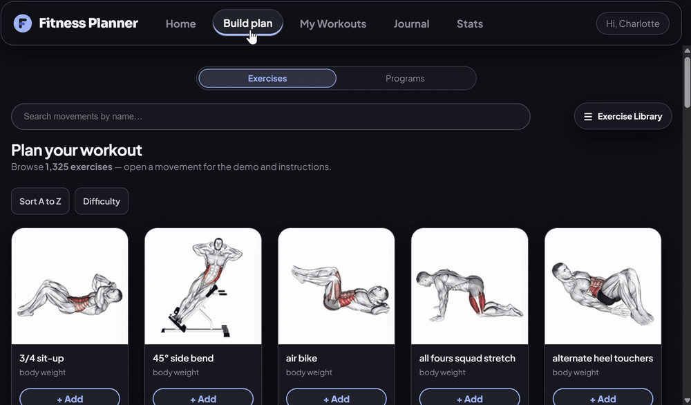
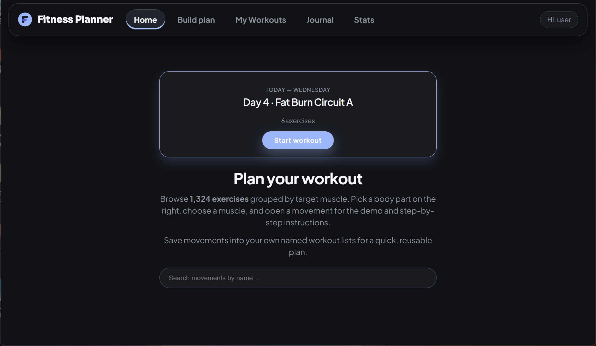

[English](README.md) | [中文](README.zh.md)

# Fitness Planner

一个围绕 1,324 个动作库搭建的全栈健身训练规划器。按 身体部位 → 目标肌肉 浏览动作、观看动画演示、创建自己的训练列表、配合休息计时器记录训练组数，并追踪恢复状态、体重与力量均衡分析。支持中文、英文与西班牙语界面，动作库也内置西语名称。
[](./media/demo.mp4)

## ▶️ 在线体验

<a href="https://gotham-citizen.github.io/Fitness-Planner/">
  
</a>

点击链接立即体验！部署在前端页面的请求会打到运行于 [Cloudflare Worker](https://fitness-planner.myenglishnameisbennie.workers.dev/api/health) 上的 API（数据库为 Cloudflare D1）。游客可以直接浏览动作库；注册登录后即可创建训练列表、记录训练并追踪进度。

## 快速开始

### 前置要求

- Node.js（v24+）
- 可选：Cloudflare 账号 —— 仅在需要部署自己的 API 或连接远程 D1 数据库时需要

### 安装

```bash
npm install
npm run fetch:data        # 下载数据集 + 动作媒体文件到 public/ 和 server/data/
npm run db:gen           # 从数据集生成 server/sql/generated/seed.sql
npm run db:schema:local  # 创建本地（Miniflare）D1 表结构
npm run db:data:local    # 导入种子数据
npm run db:test:gen      # 重新生成 server/sql/generated/test-data.sql（日期相对当天计算）
npm run db:test:local    # 导入测试数据（六个月训练历程，本周 4 个会话）
npm run dev              # Vite（网页端，:5173）+ wrangler dev --local（API，:8787）
```

打开 `http://localhost:5173`，完全离线可用。

> `server/data/` 和 `server/sql/generated/` 按设计被 gitignore —— 新 clone 的仓库通过 `npm run fetch:data`、`npm run db:gen` 和 `npm run db:test:gen` 重新生成。人工整理的本地化动作名保存在已跟踪的 `server/curated/` 中。登录功能还需要 `JWT_SECRET`：本地开发请在 `server/.dev.vars`（已 gitignore）中配置，例如 `JWT_SECRET=任意长随机字符串`。

本地开发的所有配置项均可省略（模板见 `.env.example`）：

| 变量 | 说明 |
| --- | --- |
| `VITE_API_BASE` | 前端部署在其他域名（如 GitHub Pages）时的 Worker API 绝对地址；同源部署可省略 |
| `VITE_BASE` | 应用被托管的基础路径 —— 默认 `/`，GitHub Pages 项目页为 `/<仓库名>/`（由部署工作流自动设置） |
| `CORS_ORIGIN` | 服务端允许调用 API 的来源，默认 `*` |
| `API_TARGET` | Vite 开发代理 `/api` 的目标 —— 默认指向本地 wrangler 开发服务器（`http://localhost:8787`） |

### 部署 Worker

```bash
npx wrangler login
npx wrangler d1 create fitness-db
#    将返回的 database_id 填入 server/wrangler.jsonc

npm run db:schema:remote
npm run db:data:remote

npx wrangler secret put JWT_SECRET --config server/wrangler.jsonc
npm run deploy                     # 构建前端，并把整套应用部署为一个 Worker
```

该 Worker 将前端产物、全部媒体和 API 部署在同一域名下（`nodejs_compat` + SPA 回退的静态资源）。也可以只运行网页端：

```bash
npm run dev:web   # 仅 Vite —— /api 走代理（默认本地 Worker，设置了 API_TARGET 则代理到已部署的 Worker）
npm run dev:api   # 仅 wrangler dev --local（端口 8787）
```

### 将前端部署到 GitHub Pages

GitHub Pages 只能托管静态文件，因此 API 继续留在 Cloudflare Workers 上：

1. 先部署 Worker（见上一步），记下它的地址，例如 `https://fitness-planner.<你的子域>.workers.dev`。
2. 将仓库推送到 GitHub，并添加一个名为 `VITE_API_BASE` 的仓库**变量**，值为该 Worker 地址。
3. 在 **Settings → Pages** 中将 Source 设为 **"GitHub Actions"**。
4. 推送到 `main` 分支。[部署工作流](.github/workflows/deploy-pages.yml) 会以 `VITE_BASE=/<仓库名>/` + `VITE_API_BASE` 构建，并发布 `dist/`。

跨域请求由 `server/app.js` 中的 CORS 中间件放行（通过 `CORS_ORIGIN` 控制）。

### 生产构建

```bash
npm run build
npm run preview
```

## 功能特性

- **1,324 个动作的动作库** —— 按 身体部位 → 目标肌肉 → 动作 逐级浏览，附循环播放的 GIF 演示、缩略图、器械、目标/主要/次要肌肉和分步讲解
- **支持中文的搜索** —— 同时匹配英文、中文或拼音（输入 `wo tui` 即可找到 腿部 动作）；搜索框做了 IME 安全处理，拼音输入过程中不会误触发
- **预设训练计划** —— 40+ 个科学依据扎实的编排（负荷/组数/间歇/频率遵循 ACSM 立场声明），另含为「目标 × 器械 × 重点部位」空白组合自动生成的补充计划，按目标（力量、增肌、减脂塑形、耐力）、器械（健身房/哑铃/徒手/弹力带）与重点部位分组；首页按「为你推荐」「热门计划」和各部位分组展示，也可按目标/器械/肌群筛选浏览
- **训练目标问卷** —— 注册完成后立刻询问（可跳过），并可随时在 账号 → 目标与计划 中重新填写；答案（目标、经验、每周天数、器械、重点部位、单次时长）驱动首页推荐，也可自动生成每周训练计划——每个训练日一个训练清单，训练时直接显示计划组数与次数
- **每周计划排程** — 账号 → 排程 提供两种模式：**固定**（为每周几指定具体列表）或 **轮换**（有序的训练/休息列表自动循环）；当天激活的列表会在首页和开始训练入口自动浮现
- **器械浏览** —— 23 张实拍卡片（每种器械一张 PNG，位于 `public/equipment/`，"其他"固定在末尾），点击进入该器械的动作列表；可按数量、A→Z 或难度排序
- **自定义动作** —— 创建、编辑、删除自己的动作（名称、分类、目标肌肉、器械）；自动并入动作库，仅对你的账号可见；可上传自定义 GIF（base64 编码，原始文件上限 1.4 MB 以适配 D1 2 MB 行限制）或粘贴 GIF 链接；讲解文字支持中文、英文与西班牙语
- **账号体系** —— 邮箱 + 密码注册/登录（JWT 会话）；个人资料含昵称、性别、体重+体重单位（kg/lb）、训练/组重量通用单位（kg/lb）、力度量表、计时器提醒设置和界面语言
- **训练列表** —— 命名列表，支持添加/移除动作、逐动作休息计时配置、重命名和删除；大小写不敏感的重复名检测；编辑列表时可拖拽调整动作顺序
- **实时训练** —— 从任意列表开始训练；逐组记录次数、重量、kg/lb 和力度；可编辑或删除某组；**结束训练** 时拦截"有重量但没填次数"的组
- **RIR / RPE 力度记录** —— 组可按 RIR（0–4，0 = 力竭）或 RPE（6–10，10 = 力竭）评分；平均值、正式组划分和每周力度统计设有最低评分数门槛；逐组保存所用量表，旧数据也能正确渲染
- **休息计时器** —— 逐动作休息配置，支持声音（哔声 / 钟声 / 铃声）、振动和闪光提醒，全部可在 账户 → 计时器提醒 中设置
- **训练总结** —— 结束后展示逐动作的组数统计与段位进阶（坚韧 → 王者，以 StrengthLevel 全社区 1RM 均值校准），并与你之前的训练对比
- **体积对比图片** —— 每个体积档位一张图片（`<slug>.<ext>` 放入 `public/comparisons/`，支持 `.png`/`.jpg`/`.jpeg`/`.webp`/`.gif`）；总结页显示达到的最高档位对应图片，缺图时仅显示文字
- **训练量趣味对比** —— 单次训练总量（Σ 次数 × 公斤）映射为趣味物体（一台马桶 → 2×一辆校车），显示在总结与日志中
- **单列表历史** —— 回看任意一次历史训练的总结；可删除单次记录或清空整个列表的历史
- **训练日志** —— 按天记录、按列表筛选，含个人记录（卡片 + 完整页面），另有体重打卡、趋势曲线和目标体重
- **肌肉均衡** —— 已练/未练肌肉地图，以及 **结构均衡**：你的估算 1RM（Epley 类公式）对照按体重折算的力量标准，区分性别
- **恢复追踪** —— 根据近期训练计算每个目标肌肉的恢复状态，展示在训练页
- **最近肌肉** —— 最近浏览/训练过的目标会重新出现在动作库的"最近"标签里，并标注"尚未探索"
- **体重追踪** —— 打卡记录、趋势图、目标体重、单位切换（kg/lbs）；最新打卡自动同步到个人资料
- **三语、主题、响应式** —— 中文 / English / Español 界面（浏览器检测，登录后跟随账号设置），动作库内置人工整理的西语名称、预设计划文案也已本地化；深色/浅色主题、移动端底部标签栏布局
- **无追踪、媒体本地打包** —— 种子动作库无第三方追踪器、无外部媒体 CDN，全部 GIF、缩略图和器械照片均随应用本地打包（自定义动作可选粘贴 GIF 链接，封面通过 `/api/gif-cover` 解码）

## 工作原理

1. 动作库通过 API（`/api/exercises`）加载精简列表 —— 1,324 个动作来自 [hasaneyldrm/exercises-dataset](https://github.com/hasaneyldrm/exercises-dataset)，GIF 和缩略图全部本地打包在 `public/` 中；完整详情按需从 `/api/exercises/:id` 获取。
2. 游客可自由浏览（该接口使用可选鉴权）；登录后解锁自定义动作、训练列表和记录功能。
3. 从列表创建实时训练（`POST /api/workoutlists/:id/sessions`）；每一组都即时单独保存，因此刷新页面训练不丢，还能在训练中修改。
4. 结束训练（`PUT /api/sessions/:id/complete`）会校验各组、保存总结，并驱动日志、历史、恢复、均衡和段位等全部由客户端根据历史计算的功能。
5. 同一个 Express 应用（`server/app.js`）既能跑在 Cloudflare Worker 上（`server/worker.js` + D1），也能在本地运行（`wrangler dev --local` + Miniflare D1）—— 两套环境一条代码路径。

### API 参考

| 方法 | 路由 | 说明 |
| --- | --- | --- |
| GET | `/api/health` | 存活检查 |
| POST | `/api/auth/signup` | 注册 `{ email, password, name, gender?, language?, questionnaire? }` —— language 为 `en`/`zh`/`es`；可在注册时一并保存问卷答案 |
| POST | `/api/auth/login` | 登录 `{ email, password }` |
| GET | `/api/auth/me` | 当前用户（含问卷答案 `questionnaire`） |
| PUT | `/api/auth/questionnaire` | 保存目标问卷答案 `{ answers: { goal, experience, daysPerWeek, equipment, focus?, sessionMinutes? } }` |
| PUT | `/api/auth/profile` | 更新 `{ email?, name?, gender?, bodyweight?, bodyweightUnit?, unit?, effortScale?, timerSound?, timerPlaySound?, timerVibrate?, timerFlash?, language?, schedule?, plan? }` |
| DELETE | `/api/auth/me` | 注销账号 |
| GET | `/api/exercises` | 精简版动作列表（游客获得种子动作库；登录用户额外包含其自定义动作），完整详情见 `/api/exercises/:id` |
| POST | `/api/exercises` | 创建自定义动作 `{ name, category, target, equipment?, gifUrl?, instructions?, instructionSteps?, instructionsLang? }` |
| GET | `/api/exercises/:id` | 单个动作详情 |
| PUT | `/api/exercises/:id` | 更新自定义动作 `{ name?, instructions?, instructionSteps?, instructionsLang? }` |
| DELETE | `/api/exercises/:id` | 删除自定义动作（同时删除其上传的 GIF） |
| POST | `/api/media` | 上传自定义动作 GIF（原始 `image/gif` 请求体，上限 1.4 MB）→ `{ id, url }` |
| GET | `/api/media/:id` | 提供自定义动作 GIF |
| GET | `/api/gif-cover?url=…` | 将粘贴的 GIF 链接解码为缓存的 PNG 封面 |
| GET | `/api/workoutlists` | 全部训练列表及其动作 |
| POST | `/api/workoutlists` | 创建列表 `{ name, exerciseId? }`，或按预设/计划创建 `{ name, exercises: [{ exerciseId, prescribedSets?, prescribedReps?, restSecs? }] }` |
| PUT | `/api/workoutlists/:id` | 重命名列表 `{ name }` |
| DELETE | `/api/workoutlists/:id` | 删除列表（历史记录仍保留在日志中） |
| POST | `/api/workoutlists/:id/exercises` | 添加动作 `{ exerciseId, prescribedSets?, prescribedReps?, restSecs? }` |
| DELETE | `/api/workoutlists/:id/exercises/:exerciseId` | 从列表移除动作 |
| PUT | `/api/workoutlists/:id/exercises/:exerciseId` | 更新逐动作设置 `{ restSecs?, restEnabled?, rirEnabled?, prescribedSets?, prescribedReps? }` |
| PUT | `/api/workoutlists/:id/exercises/reorder` | 保存拖拽排序后的完整 `order` |
| POST | `/api/workoutlists/:id/sessions` | 开始一次训练 |
| GET | `/api/workoutlists/:id/sessions` | 单个列表的训练历史 |
| DELETE | `/api/workoutlists/:id/sessions` | 清空列表历史 |
| GET | `/api/sessions` | 你的全部训练记录（含已删除列表） |
| GET | `/api/sessions/:sessionId` | 单次训练及其组记录 |
| DELETE | `/api/sessions/:sessionId` | 删除一次训练 |
| PUT | `/api/sessions/:sessionId/complete` | 校验并结束训练 |
| PUT | `/api/sessions/:sessionId/bodyweight` | 训练中记录体重 |
| POST | `/api/sessions/:sessionId/sets` | 记录一组 `{ exerciseId, setNumber, reps, weight, weightUnit, rir, effortScale }` |
| PUT | `/api/sessions/:sessionId/sets/:setId` | 修改一组 |
| DELETE | `/api/sessions/:sessionId/sets/:setId` | 删除一组 |
| GET | `/api/bodyweight` | 体重打卡历史 |
| POST | `/api/bodyweight` | 记录体重 `{ weight, unit, loggedAt }` |
| DELETE | `/api/bodyweight/:id` | 删除一条体重记录 |
| PUT | `/api/bodyweight/goal` | 设置目标体重 |

## 技术栈

### 前端

- **React 19** —— UI 组件与 hooks
- **Vite** —— 开发服务器、代理与构建工具
- **i18next + react-i18next** —— 完整的国际化方案（`en`/`zh`/`es`），含浏览器语言检测与按账号记忆语言；翻译文件位于 `src/utils/locales/{en,zh,es}/translation.js`
- **pinyin-pro** —— 拼音转换，使中文搜索也能匹配输入的拼音
- **原子化组件架构** —— `src/components/` 按 atoms → molecules → organisms → templates 分层，每层提供桶文件 `index.js`
- **原生 CSS** —— 组件样式随组件就近存放，全局主题变量在 `src/index.css`
- **ESLint flat 配置** —— import 排序、React hooks、refresh 与 simple-import-sort 规则

### 后端 / 基础设施

- **Express 5** —— API 路由，通过 `server/worker.js` 运行在 Cloudflare Workers（`nodejs_compat`）上
- **Cloudflare D1**（SQLite）—— 动作、自定义动作、用户、训练列表、训练记录、组数、体重打卡（`server/sql/schema.sql`）
- **jose** —— JWT 签发/校验（HS256），密钥仅保存在服务端
- **Web Crypto PBKDF2** —— 密码哈希（10 万次迭代，SHA-256，每用户独立盐值）
- **imagescript** —— 将粘贴的 GIF 链接解码为缓存的 PNG 封面（`/api/gif-cover`）
- **Wrangler** —— Workers/D1 命令行工具，用于本地开发（Miniflare）与部署
- **GitHub Actions** —— CI/CD 流水线，构建并部署到 GitHub Pages

## 项目结构

```
├── index.html                       # HTML 外壳
├── vite.config.js                   # Vite 配置（/api 开发代理、VITE_BASE）
├── eslint.config.js                 # ESLint flat 配置
├── .env.example                     # 可选 .env 配置模板
├── .github/workflows/
│   └── deploy-pages.yml             # GitHub Actions：构建并部署到 Pages
├── public/                          # 原样托管的静态媒体
│   ├── images/                      # 1,324 张动作缩略图
│   ├── videos/                      # 1,324 个动作 GIF 演示
│   ├── equipment/                   # 器械卡片照片（<slug>.png，共 23 张卡片）
│   ├── comparisons/                 # 体积对比图片（<slug>.<ext>，共 14 档）
│   ├── icons.svg                    # 内联 SVG 精灵图供 UI 图标使用
│   └── favicon.svg
├── media/                           # README 演示素材（demo.gif / demo.png / demo.mp4）
├── scripts/
│   ├── download-assets.mjs          # 下载数据集 + 媒体到 public/ 和 server/data/
│   ├── generate-seed.mjs            # 生成 server/sql/generated/seed.sql（补充拼音、中文名、西班牙语名、难度）
│   └── generate-test-data.mjs       # 生成 server/sql/generated/test-data.sql（生成文件，已 gitignore）
├── shared/                          # 客户端与服务端共用模块
│   ├── normalize.js                 # 力度量表 / 语言 / 单位归一化
│   └── setRules.js                  # 组有效性规则（有重量无次数等）
├── server/
│   ├── app.js                       # Express 应用：CORS、鉴权、全部 API 路由
│   ├── worker.js                    # Cloudflare Workers 入口
│   ├── db.js                        # D1 数据访问层（用户、动作、列表、训练、体重）
│   ├── auth.js                      # PBKDF2 哈希 + JWT 签发/校验（jose）
│   ├── authMiddleware.js            # requireAuth / optionalAuth 鉴权中间件
│   ├── validate.js                  # 邮箱 / 性别 / 数字校验
│   ├── curated/                     # 已跟踪的人工本地化动作名（exercise-names-es.json）
│   ├── sql/
│   │   ├── schema.sql               # D1 表结构（破坏性重置 —— 仅用于全新数据库）
│   │   └── generated/               # 生成的 seed.sql + test-data.sql（已 gitignore）
│   ├── wrangler.jsonc               # Worker 配置（静态资源、D1 绑定、nodejs_compat）
│   ├── .dev.vars                    # 本地密钥（gitignored）—— JWT_SECRET
│   └── data/                        # 生成的数据集与中文名（gitignored）
└── src/
    ├── main.jsx                     # React 挂载入口
    ├── index.css                     # 全局样式 + 主题变量
    ├── app/                         # 轻量页面壳 —— 每个视图一个文件夹
    │   ├── App.jsx                  # 根状态机：鉴权、列表、训练、导航
    │   ├── HomePage/                # 首页仪表盘 + 搜索入口 + 排程浮现
    │   ├── PlannerPage/             # 动作库浏览（层级 / 搜索 / 器械）
    │   ├── WorkoutsPage/            # 训练列表 + 恢复面板
    │   ├── SessionPage/             # 实时训练记录
    │   ├── SummaryPage/             # 训练后总结（段位、历史最佳、训练量对比）
    │   ├── HistoryPage/             # 单列表训练历史
    │   ├── WorkoutHistoryPage/      # 全部训练记录视图
    │   ├── JournalPage/             # 按天日志 + 体重卡片
    │   ├── PersonalRecordsPage/     # 完整的个人记录页
    │   ├── BalancePage/             # 肌肉均衡 + 结构均衡
    │   ├── PlanSchedulePage/        # 每周计划排程编辑器
    │   ├── AccountPage/             # 个人资料设置（问卷、排程、计时器提醒）
    │   ├── AuthPage/                # 登录 / 注册（含新用户问卷引导）
    │   └── TimerAlertsPage/         # 休息计时器提醒设置
    ├── components/
    │   ├── atoms/                   # 单一职责 UI（Button、TextInput、LineChart、
    │   │                            #   EquipmentImage、ThemeToggle、SegmentedToggle 等）
    │   ├── molecules/               # 原子组合（SearchBar、RestTimer、ExerciseBrowser、
    │   │                            #   CustomExerciseForm、MuscleBodyMap、WeighInsModal 等）
    │   ├── organisms/               # 完整视图（ExerciseLibrary、MovementDetail、
    │   │                            #   WorkoutSessionView、StructuralBalance、RecoveryPanel 等）
    │   └── templates/               # 页面骨架（AppShell、AuthTemplate、PlannerTemplate 等）
    ├── hooks/                       # 可复用 hook（抽屉、拖拽排序、滚动记忆等）
    ├── lib/                         # 领域逻辑（纯模块，可单元测试）
    │   ├── api.js                   # API 客户端（fetch + JWT + 同源或 VITE_API_BASE）
    │   ├── muscles.js               # 层级构建、搜索（英/中/拼音）、媒体地址
    │   ├── exerciseIds.js           # 预设动作名 → 动作库 id 映射
    │   ├── planGenerator.js         # 问卷答案 -> 每周计划（每个训练日一个清单）
    │   ├── presets/                 # 预设训练库（精选 + 自动生成的补充计划）：
    │   │                            #   goals.js、bodyParts.js、localize.js、coverage.js、
    │   │                            #   strength.js、build.js、slim.js、endurance.js、focus.js、
    │   │                            #   index.js（解析、分组、本地化、构建载荷）
    │   ├── equipmentGroups.js       # 器械归组（23 张卡片、"其他"桶）
    │   ├── effort.js                # RIR/RPE 换算 + 力度统计
    │   ├── ranks.js                 # 坚韧→王者 段位表（StrengthLevel 校准）
    │   ├── onerm.js                 # 1RM 估算公式（Epley、Brzycki 等）
    │   ├── personalRecords.js       # 个人记录识别与历史
    │   ├── structuralBalance.js     # 力量标准 vs 体重（区分性别）
    │   ├── structuralBalanceTemplates.js # 结构均衡用的训练模板
    │   ├── recovery.js              # 逐肌肉恢复计算
    │   ├── bodyweight.js            # 体重换算 + 个人资料辅助
    │   ├── bodyweightChart.js       # 体重趋势图数据
    │   ├── summary.js               # 训练总结聚合 + 训练量对比
    │   ├── journal.js               # 日志日期键 + 训练分组
    │   ├── timerAlert.js            # 计时声音（哔/钟/铃）、振动、闪光
    │   ├── schedule.js              # 每周计划排程（固定/轮换）归一化
    │   ├── dates.js                 # 日期工具（周边界、格式化）
    │   ├── timeWindow.js            # 近期时间窗辅助（恢复 / 统计）
    │   ├── muscleMap.js             # 肌肉 → 身体部位共享映射
    │   ├── units.js                 # kg/lbs 换算
    │   ├── storage.js               # localStorage 辅助（主题、语言、最近）
    │   ├── recent.js                # 最近浏览/训练肌肉追踪
    │   ├── setValidation.js         # 客户端组规则（镜像服务端）
    │   ├── format.js                # 数字/日期格式化
    │   └── validation.js            # 客户端表单校验
    └── utils/
        ├── i18n.js                  # i18next 初始化（en/zh/es）+ 语言持久化
        ├── locale.js                # 应用语言 → Intl 区域映射
        ├── themes.js                # 主题令牌
        ├── format.js                # 数字/日期格式化
        ├── validation.js            # 客户端表单校验
        └── locales/
            ├── en/translation.js    # 英文 UI 文案 + 肌肉/器械词典
            ├── zh/translation.js    # 中文 UI 文案 + 肌肉/器械词典
            └── es/translation.js    # 西语 UI 文案 + 肌肉/器械词典
```

## 语言支持

未登录时，界面跟随浏览器语言。登录后切换为账号保存的语言（缓存在 `localStorage`，刷新不闪烁）；退出登录会清除缓存并回到浏览器语言。新账号默认使用注册时选择的界面语言。搜索同时匹配英文、中文和拼音。

| 语言 | UI 检测 | 搜索匹配 |
| --- | --- | --- |
| English | `navigator.language` 兜底（默认） | 英文文本 |
| 中文 | 浏览器以 `zh` 开头，或个人资料设置 | 中文字符 + 输入的拼音（`pinyin-pro`；种子库另有预计算 `name_pinyin` 列） |
| Español | 浏览器以 `es` 开头，或个人资料设置 | 英文文本（西语动作名仅用于展示） |

支持的语言统一在 `src/utils/i18n.js` 的 `SUPPORTED_LANGUAGES` / `normalizeLanguage` 中声明；服务端在注册和资料更新时放行这些值。新增语言的方法：在 `src/utils/locales/<lang>/` 下添加 `translation.js`（包含用于身体部位/器械名称的 `muscles.*` 词典），在 `src/utils/i18n.js` 中注册，扩展 `src/utils/locale.js` 的语言映射，并在 `server/app.js` 的注册与资料更新接口中放行新语言值。拼音匹配仅限中文，可跳过。

## 开发工作流

### 数据流水线

1. **`npm run fetch:data`** —— 从上游数据集下载 `exercises.json` 及全部 1,324 个 GIF + 缩略图到 `public/videos/` 与 `public/images/`（保持数据集的相对路径），同时把 JSON 存到 `server/data/exercises.json`。
2. **`npm run db:gen`** —— 读取本地 JSON，合并 `server/data/exercise-names-zh.json` 中的人工中文名和 `server/curated/exercise-names-es.json` 中的人工西班牙语名，用 `pinyin-pro` 计算拼音与首字母，按确定性规则分配 1–3 难度档，输出 `server/sql/generated/seed.sql`（`exercises` 表的 `INSERT` 语句）。
3. **`npm run db:schema:local`** —— 把 D1 表结构应用到本地 Miniflare 数据库（破坏性重置）。
4. **`npm run db:data:local`** —— 导入种子数据。
5. **`npm run db:test:gen`** —— 生成确定性测试数据（`server/sql/generated/test-data.sql`，已 gitignore）：测试用户、3 个训练列表、跨六个月的 26 个会话（22 个按周分布 + 本周 4 个）、26 条趋向 68 kg 目标的体重打卡、问卷与推/拉/腿轮换排程数据。脚本在写入前**断言**覆盖度：
   - 15 个里程碑会话按顺序命中每个对比档位，最终达到 2× 校车体积（公斤与磅阶梯一致）
   - 女性标准表覆盖全段位（坚韧 → 王者 + Unranked）
   - 分块力度设计（全未评分、旧数据硬核、简单偏向、全频段含 RPE）
   - 总体积与单动作重量单调递增（新最佳徽章持续触发）
   - 近期会话落在当前以周日为起始的周内，且不会出现在未来
6. **`npm run db:test:local`** —— 应用测试数据（幂等：先删再插 `test-` 前缀行）。

   生成的 SQL 不提交到仓库：加载前先运行 `npm run db:gen` 和 `npm run db:test:gen`。`npm run db:schema:local/remote` 是破坏性操作 —— 它会删除所有表并重新应用 `server/sql/schema.sql`。仅对本地 Miniflare 或全新的远程 D1 使用；切勿对已有用户的远程数据库重复执行。现有数据库会在运行时补充新列，而 `es` 语言值等表结构变更通过迁移应用，而不是破坏性重置。

### 本地开发命令

| 命令 | 说明 |
| --- | --- |
| `npm run dev` | 并发运行 Vite（`:5173`）+ wrangler dev（`:8787`） |
| `npm run dev:web` | 仅 Vite —— `/api` 代理到本地 Worker（或 `API_TARGET`） |
| `npm run dev:api` | 仅 wrangler dev --local（`:8787`） |
| `npm run build` | 生产构建到 `dist/` |
| `npm run preview` | 预览构建产物 |
| `npm run lint` | 全项目 ESLint 检查 |

### 测试账号

执行 `npm run db:test:local` 后，使用以下凭据登录：

- **邮箱：** `123456@gmail.com`
- **密码：** `123456`

该账号已填好问卷（目标：增肌、经验：中级、每周 3 天、健身房、60 分钟），配置了推/拉/腿轮换排程，并拥有跨六个月的 26 个会话，覆盖全部段位与对比档位。

## 数据库结构

核心表（完整 DDL 见 `server/sql/schema.sql`）：

| 表 | 用途 |
| --- | --- |
| `users` | 身份与偏好（问卷、排程、体重、力度量表、计时器提醒、语言） |
| `exercises` | 共享种子库（`user_id` 为 NULL）+ 用户自定义动作；含中文名/西语名、拼音/首字母（搜索）、难度档与可选的粘贴 `gif_url` |
| `exercise_media` | Base64 编码的自定义 GIF（原始上限 1.4 MB） |
| `workout_lists` | 用户的命名列表；用户级唯一名（大小写不敏感） |
| `workout_list_exercises` | 列表内动作及其逐动作设置（休息、计划组数/次数、手动 `position`） |
| `workout_sessions` | 已完成会话（训练时的列表名与体重快照） |
| `workout_session_sets` | 单组记录：次数、重量、单位、RIR、effort_scale |
| `bodyweight_log` | 体重打卡历史（含单位与时间戳） |

索引覆盖常见查询：按分类/目标/用户查动作、按用户查列表、按列表查会话、按会话/动作查组数、按用户+日期查体重。

## 安全说明

密码绝不会以明文离开服务器 —— 在 `server/auth.js` 中使用 Web Crypto PBKDF2（10 万次迭代、SHA-256、16 字节每用户盐值）哈希。会话令牌为由服务端 `JWT_SECRET` 签名的 JWT（生产环境为 Worker secret，本地为 `server/.dev.vars` —— 两者均已 gitignore）；客户端只保存令牌并以 Bearer 头发送。CORS 通过 `CORS_ORIGIN` 配置（默认 `*` —— 生产环境建议限制为你的 Pages 域名）。没有第三方追踪器，种子动作库的 GIF、缩略图和器械照片均随应用本地打包。自定义动作可选粘贴 GIF 链接；封面由服务端通过 `/api/gif-cover` 解码（校验 http(s) 链接、大小与文件头，并做缓存）。

## 扩展项目

### 向种子库添加新动作

1. 向上游 [hasaneyldrm/exercises-dataset](https://github.com/hasaneyldrm/exercises-dataset) 提交或 fork 数据集。
2. 运行 `npm run fetch:data` 拉取更新后的 JSON + 媒体。
3. 若需中文名，在 `server/data/exercise-names-zh.json` 增加条目（键 = 动作 id，值 = 中文名）；西语名同理，加到 `server/curated/exercise-names-es.json`。
4. 运行 `npm run db:gen` → `npm run db:data:local`（或 remote）。

### 添加新预设训练

编辑 `src/lib/presets/` 下的数据文件（`strength.js`、`build.js`、`slim.js`、`endurance.js`、`focus.js`，以及填补「目标 × 器械 × 重点部位」空白的 `coverage.js` 动作池），遵循现有结构，重新构建即可。名称与描述采用内联 `{ en, zh, es }` 结构（见 `localize.js`）；`goals.js` 的元数据将目标/器械/难度映射到对应的预设文件。

### 添加新语言

1. 创建 `src/utils/locales/<lang>/translation.js`，包含全部 UI 文案 + `muscles.*` 词典。
2. 在 `src/utils/i18n.js` 的 `resources` 中注册。
3. 扩展 `src/utils/locale.js`（语言 → Intl 区域映射）。
4. 在 `server/app.js` 的注册与资料更新接口中放行新语言代码。
5. 运行 `npm run dev` 测试。

## 许可证

MIT

### 致谢

本项目使用的数据来自：

- **[hasaneyldrm/exercises-dataset](https://github.com/hasaneyldrm/exercises-dataset)** —— 1,324 个动作的动作库（名称、分类、肌肉、器械、讲解、GIF、缩略图）

UI/UX 设计灵感来源：

- **[emilfunk/opengym](https://github.com/emilfunk/opengym)** —— 训练追踪器的界面模式与交互设计

两个上游项目均为 MIT 协议。感谢维护者们开源共享。